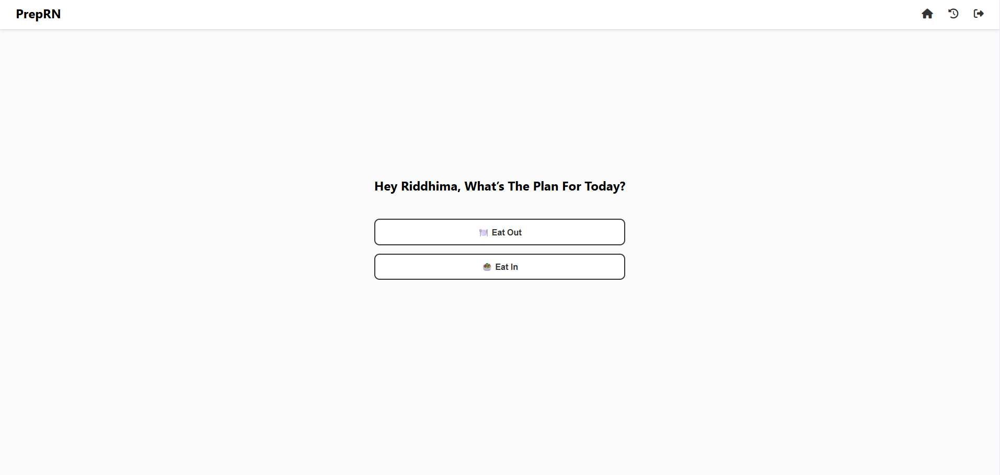
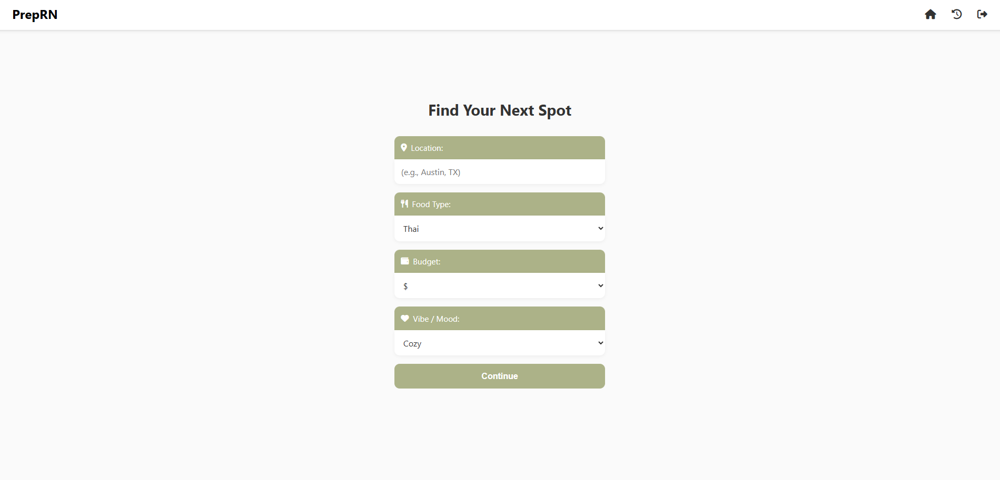
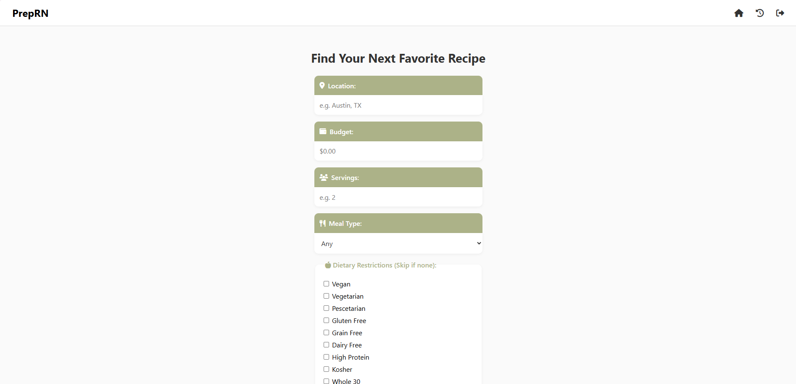
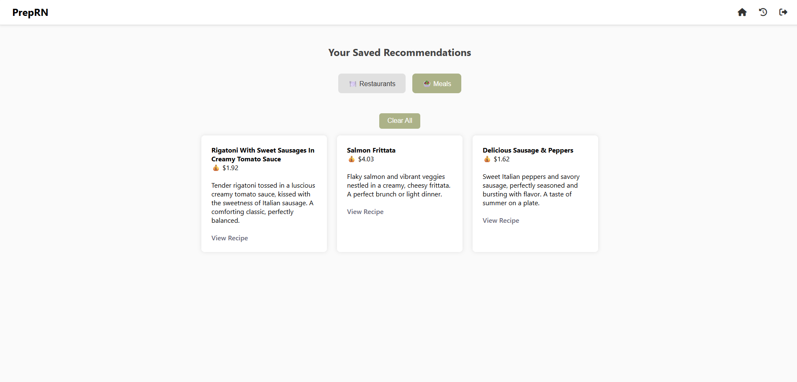

# 🍽️ PrepRN - AI-Powered Meal Planning Platform

> **Full-stack web application that revolutionizes meal planning through intelligent restaurant discovery and AI-powered recipe recommendations.**

[](https://python.org)
[](https://flask.palletsprojects.com/)
[](https://sqlalchemy.org)
[](https://ai.google.dev/)

## 🚀 **Live Demo**
**🔗 [View Live Application](https://preprn.pythonanywhere.com/)**

---

## 🎯 **What Makes This Special**

PrepRN isn't just another food planning app—it's a **sophisticated full-stack platform** that demonstrates my development skills:

### **🧠 AI-Powered Intelligence**
- **Google Gemini AI** integration for personalized meal descriptions and restaurant descriptions
- **Real-time content generation** with error handling and fallback systems
- **Smart recommendation algorithms** that learn from user preferences (coming soon)

### **🔌 Multi-API Architecture**
- **Yelp Fusion API** - Real-time restaurant data with 50+ filter combinations
- **Spoonacular API** - 380,000+ recipes with nutritional analysis
- **Google Generative AI** - Dynamic content creation and meal and restaurant optimixation

### **🏗️ Professional Backend Architecture**
- **Modular design** with `FoodiesRN` and `PrepnGo` microservices
- **SQLAlchemy ORM** with complex relational database design
- **Session management** and secure user authentication
- **RESTful API endpoints** with proper error handling

---

## 🛠️ **Technical Stack**

### **Backend**
- **Python 3.9+** - Core application logic
- **Flask 2.3.2** - Web framework with blueprints
- **SQLAlchemy 2.0.16** - Database ORM and migrations
- **WTForms** - Form validation and CSRF protection
- **python-dotenv** - Environment variable management

### **Frontend**
- **Jinja2** - Server-side templating with inheritance
- **Custom CSS3** - Responsive design with animations
- **JavaScript ES6** - Dynamic UI interactions
- **Font Awesome** - Professional iconography

### **APIs & Services**
- **Yelp Fusion API** - Restaurant discovery and reviews
- **Spoonacular API** - Recipe database and nutrition data
- **Google Gemini AI** - Content generation and meal and restaurant optimization
- **SQLite** - Development database

### **Development Tools**
- **Git** - Version control with feature branches
- **Flask-WTF** - CSRF protection and form handling
- **Modular architecture** - Separated concerns and scalability

---

## 🏆 **Key Features**

### **🍽️ FoodiesRN - Intelligent Restaurant Discovery**
- **Advanced filtering** by cuisine, price, location, and vibe
- **AI-generated descriptions** using Google Gemini
- **Real-time Yelp integration** with ratings and reviews
- **Personalized recommendations** based on user history (coming soon)
- **Interactive UI** with loading states and animations

### **🥗 PrepnGo - Smart Meal Planning**
- **Budget-conscious planning** with cost per serving calculations
- **Dietary restriction handling** (15+ diet types supported)
- **AI-powered meal summaries** and nutrition insights
- **Local grocery store suggestions** generated by AI
- **Meal prep optimization** for busy lifestyles

### **👤 User Experience**
- **Secure authentication** with session management
- **Persistent recommendations** with database storage (coming soon)
- **Real-time feedback** and loading indicators
- **Intuitive navigation** with tabs

---

## 🗄️ **Database Design**

### **Complex Relational Schema**
```sql
📊 Users Table
├── Authentication & session management
├── User preferences and history

🍽️ FoodiesRN Recommendations
├── Restaurant data with Yelp integration
├── User-specific saved recommendations
├── Geographic and preference filtering

🥗 PrepnGo Meal Planning
├── Requests table (budget, servings, dietary needs)
├── Meals table (recipes, prices, nutrition data)
├── Local stores table (AI-generated shopping suggestions)
└── Feedback table (user satisfaction tracking) (coming soon)
```

---

## 🚀 **Getting Started**

### **Prerequisites**
- Python 3.9 or higher
- pip package manager
- API keys for Yelp, Spoonacular, and Google AI

### **Installation**

1. **Clone the repository**
   ```bash
   git clone https://github.com/riddhimayadav/PrepRN-Full-Stack-App.git
   cd PrepRN-Full-Stack-App
   ```

2. **Set up virtual environment**
   ```bash
   python -m venv venv
   source venv/bin/activate  # On Windows: venv\Scripts\activate
   ```

3. **Install dependencies**
   ```bash
   pip install -r requirements.txt
   ```

4. **Configure environment variables**
   ```bash
   cp .env.example .env
   # Edit .env with your API keys:
   # YELP_KEY=your_yelp_api_key
   # SPOON_API_KEY=your_spoonacular_key
   # GOOGLE_API_KEY=your_google_ai_key
   ```

5. **Initialize the database**
   ```bash
   python -c "from shared.auth import create_user_table; create_user_table()"
   ```

6. **Run the application**
   ```bash
   python app.py
   ```

7. **Access the app**
   Open `http://localhost:5000` in your browser

---

## 📱 **Application Screenshots**

### Dashboard - Clean, Professional Interface


### Restaurant Discovery - Real-time API Integration



### Meal Planning - AI-Powered Recommendations



### Saved Recommendations - Persistent User Data



---

## 🔧 **API Integration Details**

### **Yelp Fusion API**
- **Endpoint**: `/v3/businesses/search`
- **Rate Limiting**: Handled with exponential backoff
- **Error Handling**: Graceful degradation to mock data
- **Features**: Location-based search, price filtering, cuisine categories

### **Spoonacular API**
- **Endpoint**: `/recipes/random` & `/recipes/complexSearch`
- **Features**: Dietary restrictions, budget constraints, nutritional data
- **Optimization**: Batch requests and intelligent caching

### **Google Gemini AI**
- **Model**: `gemini-1.5-flash`
- **Use Cases**: Meal descriptions, nutrition tips, store suggestions
- **Safety**: Input sanitization and content filtering
- **Fallbacks**: Default content when API is unavailable

---

## 🏗️ **Architecture Highlights**

### **Modular Design**
```python
📁 FoodiesRN/           # Restaurant discovery microservice
├── Yelp API integration
├── AI content generation
└── Database persistence

📁 prepngo/             # Meal planning microservice
├── Spoonacular integration
├── Budget optimization
└── Grocery store suggestions

📁 shared/              # Common utilities
├── Authentication system
├── Database helpers
└── API utilities
```

### **Professional Patterns**
- **Database Abstraction** - SQLAlchemy ORM for scalability
- **Error Handling** - Comprehensive exception management
- **Security** - CSRF protection and input validation
- **Scalability** - Modular design ready for microservices

---